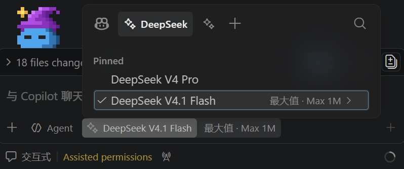

<h1 align="center">DeepSeek for Copilot Chat (Community Fork)</h1>

<p align="center">
  <!-- marketplace-readme:remove-start -->
  <a href="https://marketplace.visualstudio.com/items?itemName=fallenstarowo.deepseek-for-copilot-chat"></a>
  <br/>
  <!-- marketplace-readme:remove-end -->
  
  
</p>

<p align="center">
  简体中文 |
  <a href="https://github.com/FallenstarOwO/deepseek-for-copilot/blob/main/README.en.md">English</a>
</p>

**在 Copilot Chat 模型选择器中直接使用 DeepSeek V4——保留 Agent 模式、工具调用与 Skills，无需切换界面。**

> **English summary:** Pick DeepSeek V4 from the Copilot Chat model picker and keep everything Copilot already gives you. Bring your own API key, stored in the OS keychain. [Read the English README →](https://github.com/FallenstarOwO/deepseek-for-copilot/blob/main/README.en.md)

> **非官方社区分支。** 由 `fallenstarowo` 从 [FallenstarOwO/deepseek-for-copilot](https://github.com/FallenstarOwO/deepseek-for-copilot) 发布，与原作者 [Vizards/deepseek-v4-for-copilot](https://github.com/Vizards/deepseek-v4-for-copilot) 无隶属或背书关系；MIT 许可证与原始版权声明均予保留。两个扩展注册同一个 `deepseek` 模型 vendor，**安装本扩展前请先卸载官方版本**。

<p align="center">
  
</p>

## 模型

| 模型入口 | 图片输入 | 思考层级 | API 模型名 |
|---|---|---|---|
| **DeepSeek V4.1 Flash** | ✅ 原生 | `无` / `低` / `高` / `最大值` | `deepseek-flash` |
| **DeepSeek V4 Pro** | ❌ 仅文本 | `无` / `低` / `高` / `最大值` | `deepseek-v4-pro` |

两个入口均支持工具调用与 1M Token 上下文；思考层级在模型选择器中打开该模型的设置面板即可单独调整。计费见[模型与价格](https://api-docs.deepseek.com/zh-cn/quick_start/pricing/)。

## 功能

- **继承全部 Copilot 能力**——接入的是 Copilot 原生 provider API，Agent 模式、工具调用、Instructions、MCP、Skills 开箱即用。
- **思考层级**——支持 `reasoning_content`；`无`关闭思考，`低`（`low`）、`高`（`high`，默认）、`最大值`（`max`）调节推理强度。
- **原生视觉**——Flash 直接接收图片附件（[上下文缓存](https://api-docs.deepseek.com/zh-cn/guides/kv_cache/)需完整匹配已有前缀）；Pro 仅处理文本。
- **网页搜索与抓取**——`#deepseekSearch` / `#deepseekFetch`，接入[官方 Search/Fetch API](https://api-docs.deepseek.com/zh-cn/guides/search)，按成功请求计费；可用 `webTools.search.enabled` / `webTools.fetch.enabled` 分别关闭。
- **OCR 文字识别**——`#deepseekOcr`，接入[官方 OCR API](https://api-docs.deepseek.com/zh-cn/guides/ocr)：给 Pro 补"眼睛"，或从 PDF/Word/PPT/图片提字。**默认关闭**（`ocr.enabled`），按识别页数计费；只处理工作区内或绝对路径的**文件**，聊天中的图片附件不会自动走 OCR。
- **余额查询**——`DeepSeek: 查询余额` 打开面板（含[用量页](https://platform.deepseek.com/usage)入口）；状态栏同步显示余额，点击即刷新（`statusBar.balance.enabled` / `refreshIntervalMinutes`）。
- **安全与轻量**——API Key 存于系统密钥链（`SecretStorage`），不会写入 `settings.json`；纯 VS Code API + Node 内置模块，无额外进程。

## 快速开始

**前置条件**：VS Code 1.116+（依赖非公开 Copilot Chat API，较新版本可能不兼容，遇到问题请[提 Issue](https://github.com/FallenstarOwO/deepseek-for-copilot/issues)）、GitHub Copilot 订阅（免费版可用）、[DeepSeek API Key](https://platform.deepseek.com)。

1. **安装**：从 [VS Code Marketplace](https://marketplace.visualstudio.com/items?itemName=fallenstarowo.deepseek-for-copilot-chat) 安装，或从 [GitHub Releases](https://github.com/FallenstarOwO/deepseek-for-copilot/releases) 下载 `.vsix` 后用 **从 VSIX 安装...**。
2. **配置 Key**：命令面板运行 **DeepSeek: 设置 API Key**，粘贴 Key（官方 Key 通常以 `sk-` 开头）。
3. **开聊**：打开 Copilot Chat → 模型选择器 → 选择 **DeepSeek V4.1 Flash** 或 **DeepSeek V4 Pro**。

## 设置项

以下均省略 `deepseek-copilot.` 前缀。

| 设置项 | 默认值 | 说明 |
|---|---|---|
| `baseUrl` | `https://api.deepseek.com` | API 端点，可指向自托管/代理。**仅用户（machine）级生效**：工作区设置被忽略，防止恶意仓库把 Key 引向第三方 |
| `requestHeaders` | `{}` | 自定义请求头，同样**仅用户级生效**。[说明](https://github.com/Vizards/deepseek-v4-for-copilot/blob/main/docs/settings/request-headers.zh.md) |
| `maxTokens` | `0` | 最大输出 Token（`0` = API 默认），可用于成本控制 |
| `modelIdOverrides` | 官方 ID 映射 | 各模型入口对应的 API 模型 ID，仅在兼容第三方 API 时修改 |
| `debugMode` | `minimal` | `minimal` 仅上报用量；`metadata` 输出隐私安全日志；`verbose` 把完整请求写入磁盘（**含敏感提示词**） |
| `experimental.stabilizeToolList` | `false` | 稳定 `tools` 列表以提高缓存命中；工具定义增多会增加 input tokens，64 个以内通常无需开启 |

其余开关：`webTools.search.enabled` / `webTools.fetch.enabled`（默认开）、`ocr.enabled`（默认关）、`statusBar.balance.enabled` / `statusBar.balance.refreshIntervalMinutes`（默认开 / 5 分钟）。

自定义 `baseUrl` 时，目标服务需实现所需接口：`POST /v1/tools/search`、`POST /v1/tools/fetch`、`POST /v1/tools/ocr`、`GET /user/balance`。这些工具始终使用你配置的 DeepSeek API Key，与当前选中的聊天模型无关。

兼容代理的 `settings.json` 示例：

```json
{
  "deepseek-copilot.modelIdOverrides": {
    "deepseek-flash": "your-v4.1-flash-model-id",
    "deepseek-v4-pro": "your-pro-model-id"
  }
}
```

## 已知问题

- **Agents 窗口的 Cloud 会话看不到 DeepSeek 模型**：Cloud 会话在 GitHub 沙箱运行且模型清单由服务端解析，第三方 BYOK 无法使用，任何设置都改变不了。请改用本地 **Copilot** 会话类型；`chat.agentHost.byokModels.enabled` 在 VS Code 1.146 默认 `true`，更早版本需显式开启。
- **Agents 窗口激活**：VS Code 1.146 起，声明 `capabilities.agentsWindow.supported` 的扩展由 Agents 窗口默认加载（本扩展自 1.0.0 起已声明），`extensions.supportAgentsWindow` 不再需要；更早版本仍需该设置。

## 方案对比

| | 本扩展 | 本地代理（如 LiteLLM） | 独立 DeepSeek 扩展 |
|---|---|---|---|
| 在 Copilot Chat 内使用 | ✅ | ✅ | ❌ 独立界面 |
| Agent 模式、工具、Skills | ✅ | ✅ | ⚠️ 自行实现 |
| 视觉支持 | ✅ 原生 | ❌ | ❌ |
| 无需额外运行进程 | ✅ | ❌ | ✅ |
| 一键安装 | ✅ | ❌ | ✅ |
| API Key 存系统密钥链 | ✅ | ❌ | ⚠️ 各异 |

## 致谢与许可证

本项目是 **Vizards** 的 [deepseek-v4-for-copilot](https://github.com/Vizards/deepseek-v4-for-copilot) 社区分支：provider 实现、i18n 脚手架与大部分架构均来自上游，MIT 许可证与原始版权声明完整保留在 [LICENSE](LICENSE) 并随构建产物分发。本分支新增网页搜索/抓取、OCR、余额查询与面板，以及流式错误处理与凭据边界加固。

[MIT](LICENSE)