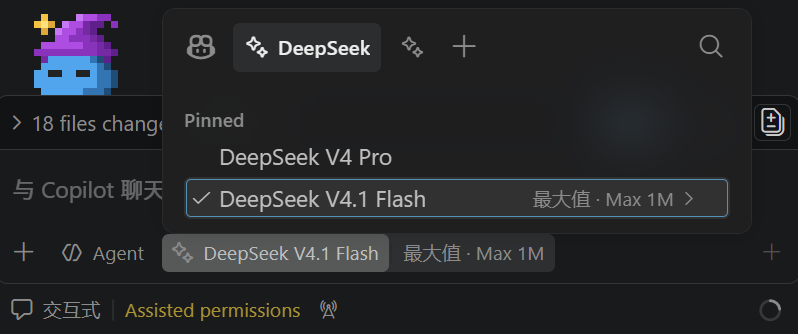

<h1 align="center">DeepSeek for Copilot Chat (Community Fork)</h1>

<p align="center">
  <!-- marketplace-readme:remove-start -->
  <a href="https://marketplace.visualstudio.com/items?itemName=fallenstarowo.deepseek-for-copilot-chat"></a>
  <br/>
  <!-- marketplace-readme:remove-end -->
  
  
</p>

<p align="center">
  <a href="https://github.com/FallenstarOwO/deepseek-for-copilot/blob/main/README.md">English</a> |
  简体中文
</p>

**在 Copilot Chat 模型选择器中直接使用 DeepSeek V4——无需离开你熟悉的 Copilot 工作流。**

> **非官方社区分支。** 由 `fallenstarowo` 从 [FallenstarOwO/deepseek-for-copilot](https://github.com/FallenstarOwO/deepseek-for-copilot) 发布，与原作者 [Vizards/deepseek-v4-for-copilot](https://github.com/Vizards/deepseek-v4-for-copilot) 无隶属或背书关系；MIT 许可证与原始版权声明均予保留。两个扩展注册同一个 `deepseek` 模型 vendor，**安装本扩展前请先卸载官方版本**。

<p align="center">
  
</p>

喜欢 DeepSeek 的性价比，但不想放弃 GitHub Copilot 的 Agent 模式、工具调用和成熟的交互体验？本扩展将 **DeepSeek V4.1 Flash 等模型**直接接入 Copilot Chat 模型选择器，支持**原生视觉**、**思考模式**，并使用你自己的 API Key。

## 为什么选这个扩展？

- **不是替换 Copilot，而是增强它。** 没有新的侧边栏，没有新的聊天界面需要学习。只是在你已经在用的模型选择器中多了一个选项。
- **Agent 模式、工具调用、Instructions、MCP、Skills——全部正常运作。** Copilot 的完整能力栈，现在跑在 DeepSeek 上。
- **原生图片输入。** V4.1 Flash 原生接收图片附件；V4 Pro 仅支持文本输入。
- **需自行提供 API Key，直接向 DeepSeek 付费。** 你的 API Key，你的账单，你的速率限制。密钥存储在操作系统密钥链中，不会以明文形式写入磁盘。

## 功能特性

### DeepSeek 模型出现在模型选择器中
选择器包含 V4.1 Flash 和 V4 Pro，支持长上下文、工具调用和可配置的思考强度。

### 原生视觉
**DeepSeek V4.1 Flash** 原生处理图片附件：图片附件会随对话内容一起直接发送给 API。**DeepSeek V4 Pro** 不支持图片输入，仅处理文本。

[上下文缓存](https://api-docs.deepseek.com/zh-cn/guides/kv_cache/)命中需要完整匹配已有的缓存前缀。

### 思考模式与思考强度控制
支持 DeepSeek 的思考模式和 `reasoning_content`。`停用`关闭思考模式；开启后可选择`轻量`（`low`）、`标准`（`high`，默认）或`深度`（`max`）。

### 继承全部 Copilot 能力
由于本扩展接入的是 Copilot 的原生 provider API，你免费获得完整能力栈：
- **Agent 模式**——自主执行多步骤任务
- **工具调用**——文件编辑、终端操作、工作区搜索、Git、测试
- **Instructions & Skills**——你的 `.instructions.md`、`AGENTS.md` 和各项 Skills 开箱即用
- **Prompt 缓存统计**——在输出通道中记录 DeepSeek 缓存命中率，直观看到成本节省

<p align="center">
  
</p>

### 官方网页搜索与抓取
两个内置工具将 Copilot Chat 接入 [DeepSeek 官方 Search / Fetch API](https://api-docs.deepseek.com/zh-cn/guides/search)：

- **`deepseek_web_search`**——返回按相关性排序的网页结果，含标题、URL、日期、站点名、摘要等。行内引用：`#deepseekSearch`。
- **`deepseek_web_fetch`**——抓取单个网页并返回 Markdown 正文。行内引用：`#deepseekFetch`。

Agent 模式下，模型会在任务需要最新网络信息时自动调用；你也可以通过聊天工具选择器添加，或在提示词中显式写 `#deepseekSearch` / `#deepseekFetch`。两个 API 均按成功请求计费——当前费率请以[官方文档](https://api-docs.deepseek.com/zh-cn/guides/search)与[价格页](https://api-docs.deepseek.com/zh-cn/quick_start/pricing)为准。

说明：
- 可在设置中搜索 `webTools` 分别关闭搜索或抓取（`webTools.search.enabled` / `webTools.fetch.enabled`）。关闭后工具会从 Copilot Chat 工具列表中隐藏，无法被调用。
- 自定义 `deepseek-copilot.baseUrl` 时，目标服务需实现 `POST /v1/tools/search` 与 `POST /v1/tools/fetch`。
- 这两个独立工具适用于本扩展的全部 DeepSeek 模型。Responses API 内置的 `web_search` 工具仅 `deepseek-v4-pro` 支持，且需要将整条对话协议切换到 `/responses`，本扩展未采用该方案。
- 无论当前选择哪个聊天模型，这两个工具都会使用你配置的 DeepSeek API Key。

### 安全优先
API Key 存储在 VS Code 的 `SecretStorage` 中（macOS 钥匙串 / Windows 凭据管理器 / Linux 密钥环）。绝不会出现在 `settings.json` 中，也不会被提交到 Git 历史。

### 零运行时依赖
纯 VS Code API + Node.js 内置模块。无需 Python、Docker 或本地代理进程。

## 快速开始

### 前置条件

- VS Code 1.116 及以上版本。本扩展依赖非公开的 Copilot Chat API，较新的 VS Code 版本可能存在兼容性问题——如遇到请[提交 Issue](https://github.com/FallenstarOwO/deepseek-for-copilot/issues)。
- GitHub Copilot 订阅（Free / Pro / Enterprise——免费版即可使用）
- DeepSeek API Key，从 [platform.deepseek.com](https://platform.deepseek.com) 获取；使用自定义 `deepseek-copilot.baseUrl` 时也可使用兼容的 provider token

### 安装方式

以下任选一种方式安装：

1. **Microsoft VS Code** — 从 [VS Code Marketplace](https://marketplace.visualstudio.com/items?itemName=fallenstarowo.deepseek-for-copilot-chat) 安装。
2. **手动安装** — 从 [GitHub Releases](https://github.com/FallenstarOwO/deepseek-for-copilot/releases) 下载 `.vsix`，在扩展视图里使用 **从 VSIX 安装...**。

### 使用步骤

1. 通过命令面板（`Cmd+Shift+P`）运行 **DeepSeek: 设置 API Key**
2. 粘贴你的 Key 或兼容的 provider token（官方 DeepSeek Key 通常以 `sk-` 开头）
3. 打开 Copilot Chat，点击模型选择器，选择 **DeepSeek V4.1 Flash** 或 **DeepSeek V4 Pro**
4. 搞定——开始聊天

## 模型

| 模型入口 | 图片处理 | 思考强度 | 官方 API 状态 |
|---|---|---|---|
| **DeepSeek V4.1 Flash** | 原生图片输入 | `停用` / `轻量` / `标准` / `深度` | 使用模型名 `deepseek-flash` 调用 |
| **DeepSeek V4 Pro** | 仅文本（不支持图片输入） | `停用` / `轻量` / `标准` / `深度` | 继续提供 API 调用服务，计费方式保持不变 |

两个入口均支持思考模式、工具调用和 1M Token 上下文。计费说明见[模型与价格文档](https://api-docs.deepseek.com/zh-cn/quick_start/pricing/)。

## 设置项

| 设置项 | 默认值 | 说明 |
|---|---|---|
| `deepseek-copilot.baseUrl` | `https://api.deepseek.com` | API 端点——可改为自托管或代理部署地址 |
| `deepseek-copilot.requestHeaders` | `{}` | 聊天补全请求的自定义请求头。[配置说明](https://github.com/Vizards/deepseek-v4-for-copilot/blob/main/docs/settings/request-headers.zh.md) |
| `deepseek-copilot.maxTokens` | `0` | 最大输出 Token 数（`0` = API 默认值）。可用于成本控制 |
| `deepseek-copilot.modelIdOverrides` | 预填官方 ID 映射 | 各 DeepSeek 模型入口对应的 API 模型 ID。仅在使用模型名不同的兼容第三方 API 时修改 |
| `deepseek-copilot.debugMode` | `minimal` | 诊断模式：`minimal` 仅上报 token 用量，`metadata` 输出隐私安全日志，`verbose` 将完整请求 dump 和 pipeline snapshot 写入扩展 global storage。完整 dump 可能包含敏感提示词文本、工具定义、文件片段和图片附件。使用 `DeepSeek: 打开请求 Dump 目录` 打开 dump 位置 |
| `deepseek-copilot.experimental.stabilizeToolList` | `false` | 实验性设置。尝试预先激活 VS Code/Copilot 的虚拟工具，让传给 DeepSeek API 的 `tools` 参数在多轮对话中更完整、更稳定。当已启用工具跨轮次变化时，可能提高上下文缓存命中率。代价是 input tokens 可能增加；缓存命中的 input tokens 单价更低，但仍会计入用量。64 个或更少已启用工具时通常无需开启，除非工具列表仍在跨轮次变化 |

思考强度可通过 Copilot Chat 的模型选择器对每个 DeepSeek 模型单独设置。

兼容 API 代理的 `settings.json` 配置示例：

```json
{
  "deepseek-copilot.modelIdOverrides": {
    "deepseek-flash": "your-v4.1-flash-model-id",
    "deepseek-v4-pro": "your-pro-model-id"
  }
}
```

## 已知问题

### Agents 窗口的 Cloud 会话中看不到 DeepSeek 模型

Agents 窗口的输入框可以切换会话类型。**Cloud** 会话在 GitHub 托管的沙箱里运行，模型清单由服务端解析，因此只有一个 `Auto` —— 第三方 BYOK 模型无法在其中使用，任何扩展设置都改变不了这一点。

请改用本地的 **Copilot** 会话类型：那里的模型选择器会把 `deepseek/deepseek-flash` 和 `deepseek/deepseek-v4-pro` 与其他 BYOK 提供方并列列出。如果本地会话里也没有，请开启 `chat.agentHost.byokModels.enabled` 并**完全重启 VS Code**，因为 agent host 按窗口缓存提供方列表。

```json
{
  "chat.agentHost.byokModels.enabled": true
}
```

扩展另外声明了 `"capabilities": { "agentsWindow": { "supported": true } }`，以便自身能在 Agents 窗口内运行。在 VS Code 1.143 / 1.144 上，该声明只有在开启 `extensions.experimental.enableAgentsWindowCapability` 后才会被采用；若希望在该窗口内使用扩展自己的命令，可设置 `extensions.supportAgentsWindow`。这两项都不影响模型是否出现——模型可用性来自 BYOK 桥接，与扩展是否在该窗口加载无关。

关于激活顺序：扩展在激活阶段同步注册 provider，并在 Copilot Chat 激活完成后刷新模型列表，因此 Copilot 启动较慢时模型选择器不会长时间为空。

### 关闭所有 VS Code 窗口后，Agents 窗口中的模型会消失

agent host 本身并不运行本扩展的 provider。开启 `chat.agentHost.byokModels.enabled` 后，它是从**正在运行的 VS Code 扩展宿主**接入 BYOK 模型的。关掉最后一个 VS Code 窗口，扩展宿主进程随之退出，DeepSeek 模型就会从 Agents 窗口的选择器中消失，进行中的请求也会失败。

规避方式：在 Agents 窗口工作期间至少保留一个 VS Code 窗口不关闭。窗口最小化即可——需要的是进程还在，而不是窗口可见。也可以改在同一个窗口的 Chat 视图里执行同样的智能体任务。这是 VS Code 侧的限制，扩展无法自行绕过。

## 方案对比

| | 本扩展 | 本地代理（如 LiteLLM） | 独立 DeepSeek 扩展 |
|---|---|---|---|
| 在 Copilot Chat 内使用 | ✅ | ✅ | ❌ 独立界面 |
| Agent 模式、工具、Skills | ✅ | ✅ | ⚠️ 自行实现 |
| 视觉支持 | ✅ 原生 | ❌ | ❌ |
| 无需额外运行进程 | ✅ | ❌ | ✅ |
| 一键安装 | ✅ | ❌ | ✅ |
| API Key 存系统密钥链 | ✅ | ❌ | ⚠️ 各异 |

## 致谢

本项目是 **Vizards** 的 **[Vizards/deepseek-v4-for-copilot](https://github.com/Vizards/deepseek-v4-for-copilot)** 的社区分支。Provider 实现、i18n 脚手架以及绝大部分架构均来自该项目——没有上游的工作，就不会有这个分支。上游以 MIT 许可证发布，其版权声明完整保留在 [LICENSE](LICENSE) 中，并随每个构建产物一同分发。

同时感谢上游的贡献者，以及在那里提交 Issue 和 PR 的每一位——本分支的功能直接建立在他们的工作之上。

本分支新增了 DeepSeek 网页搜索与网页抓取工具，并独立发布，以便这些改动在上游评审期间也能使用。

## 许可证

[MIT](LICENSE)
